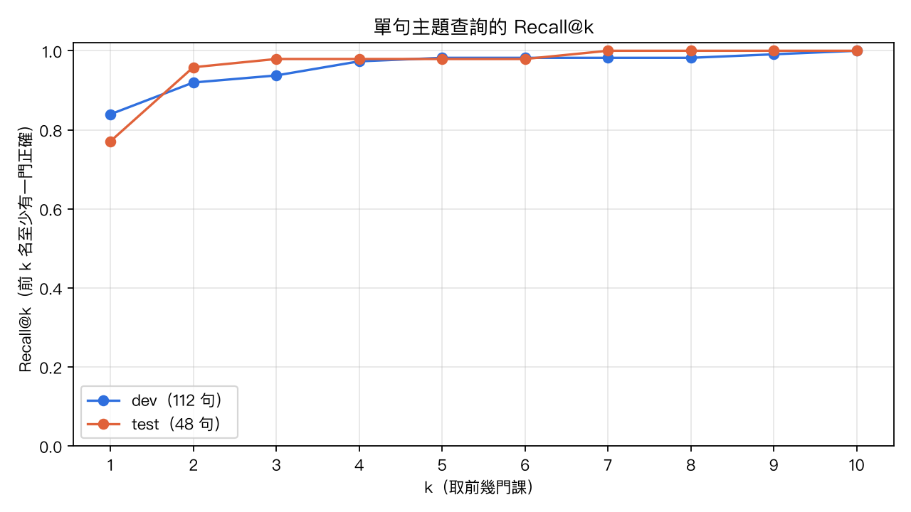
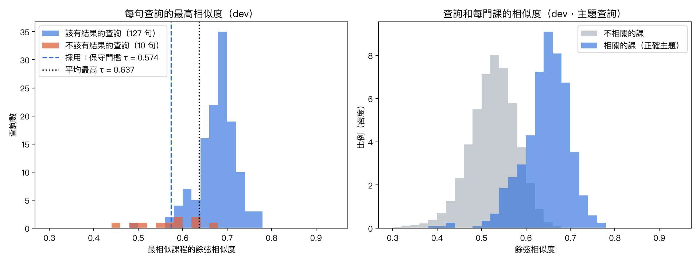
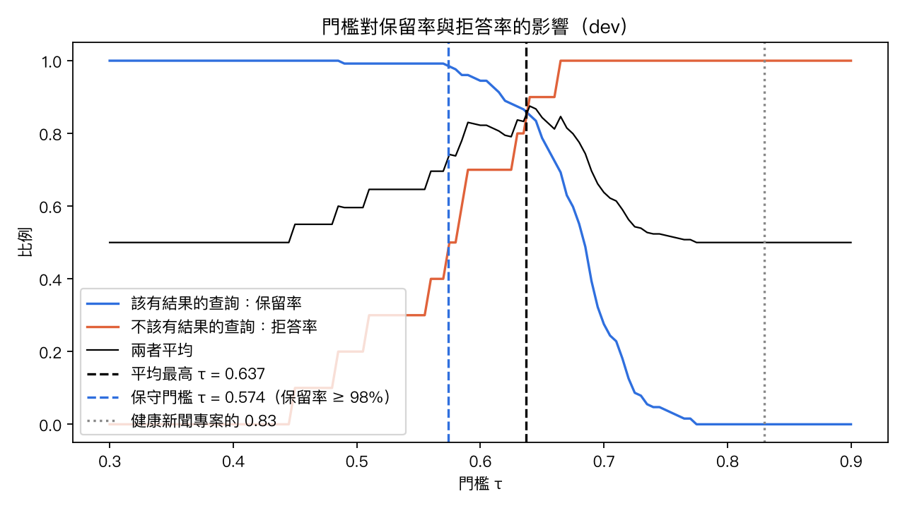
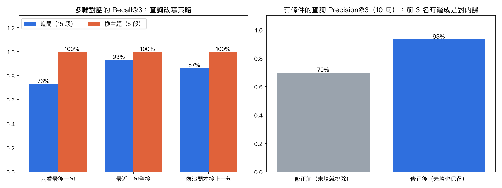

# AI 找課檢索驗收報告（P2）

> 產生方式：`uv run python -m scripts.evaluate_rag_retrieval`（需開著閘道與 bge-m3）
> 原始數字：[metrics.json](metrics.json)　查詢集：[evaluations/rag/queries.jsonl](../../../evaluations/rag/queries.jsonl)
> Embedding：bge-m3:567m（digest `7907646426…`）、426 門已發布課程、pgvector 餘弦相似度

## 1. 驗收資料

| 類型 | 句數 | 內容 | 正確答案 |
|---|---:|---|---|
| 主題查詢 | 160 | 80 個課程主題各 2 句口語問法，刻意不照抄主題名稱 | 該主題的所有課 |
| 不該有結果 | 20 | 其他樂器、寫作業、天氣、買琴、調音… | 不給課程 |
| 多輪對話 | 20 | 15 段追問（「那有沒有進階一點的？」）、5 段中途換主題 | 對話最後指的主題 |
| 有條件 | 10 | 主題＋線上／實體／預算 | 該主題中真正符合條件的課 |

- **以主題為單位標註**：同一主題有 4～6 門課（不同老師），前 k 名找到其中任一門就算命中。這也解決了同名課程的問題。
- **切分**：80 個主題打亂（seed 42），70% 的主題當 **dev**、30% 當 **test**，同一主題的問句不會同時出現在兩邊。門檻與 k 只看 dev 決定，test 只用來回報。
- **指標**：
  - **Recall@k**：前 k 名至少有一門正確的比例。
  - **MRR**：第一門正確的課排第幾名的倒數平均（1 代表都排第一）。
  - **Precision@3**：前 3 名裡有幾成是正確的課。

## 2. 單句主題查詢

| | 句數 | Recall@1 | Recall@3 | Recall@5 | Recall@6 | Recall@10 | MRR | Precision@3 |
|---|---:|---:|---:|---:|---:|---:|---:|---:|
| dev | 112 | 83.9% | 93.8% | 98.2% | 98.2% | 100% | 0.898 | 74.1% |
| test | 48 | 77.1% | 97.9% | 97.9% | 97.9% | 100% | 0.875 | 72.9% |

- 前 5～6 名之後 Recall 幾乎不再上升，所以**交給模型的課程數 k 維持 6**（PR #48 原本的設定）。再多只會讓提示詞變長，本機 4B 模型讀起來更慢。
- dev 有 7 句前 3 名沒命中，大多是主題相近的課排在前面。例如「想學巴哈那種兩個聲部的曲子」，正確答案排第 5，前面是進階的巴哈賦格課；這種情況給模型看 6 門課還是會包含正確答案。

## 3. 門檻：什麼時候說「找不到」

- **右圖**：相關的課（藍）和不相關的課（灰）分數有明顯差距，所以排序很準。
- **左圖**：每句查詢「最高分那門課」的分數。該有結果的查詢（藍）和不該有結果的查詢（橘）**重疊很多**。不該有結果的查詢最高也有 0.662（「想學打爵士鼓」，和爵士鋼琴課共用「爵士」）；該有結果的查詢最低只有 0.489。

| 門檻 | 該有結果的查詢保留率（dev／test） | 不該有結果的查詢拒答率（dev／test） | 說明 |
|---|---|---|---|
| 0.83（健康新聞專案） | 0% ／ — | 100% ／ — | bge-m3 的分數很少超過 0.78，等於全部擋掉 |
| 0.637（兩者平均最高） | 85.0% ／ 74.6% | 90% ／ 90% | 每 4～6 句正常問題就有 1 句被誤擋 |
| **0.574（採用：保守門檻）** | **98.4% ／ 100%** | **50% ／ 40%** | 保留率 ≥ 98% 的門檻中最高的 |
| 0.574＋其他樂器規則 | 同上 | **90% ／ 70%** | 規則：吉他、小提琴、爵士鼓… |

**為什麼選保守門檻：**

1. **誤擋比誤放嚴重。** 誤擋時學生看不到任何課；誤放時，模型的系統提示詞本來就規定「和學琴無關就婉拒」，還有第二道防線。
2. **分數重疊是這組模型和資料的特性，硬調門檻解決不了。** 剩下沒擋到的多半和鋼琴有關，但不是找課，例如「鋼琴多久要調音一次」0.635、「想買二手鋼琴」0.51、「我想學唱歌發聲」0.652。這類交給 P5 微調後的模型判斷意圖（找課／平台使用／無關）。

**門檻只在學生沒說任何條件時使用。** 實測發現只說條件的話，例如「我在台中，預算一堂1000以內」只有 0.527、「有線上課嗎」只有 0.557，都低於門檻，但照條件篩出來的課就是正確答案。

## 4. 多輪對話的查詢改寫

| 策略 | 追問（15 段） | 換主題（5 段） | 全部 Recall@3 |
|---|---:|---:|---:|
| 只看最後一句 | 73.3% | 100% | 80.0% |
| **最近三句全部接起來（採用，PR #48 原本的做法）** | **93.3%** | **100%** | **95.0%** |
| 像追問才接上一句（參考健康新聞專案） | 86.7% | 100% | 90.0% |

- 原本擔心「全部接起來」遇到中途換主題時會被舊主題拉走，所以另外加了 5 段換主題的對話。結果三種策略都 100%：學生換主題時通常會清楚說出新主題，bge-m3 會以新主題為主。
- 「像追問才接上一句」靠規則判斷，例如「他很喜歡卡通歌」不像追問，就漏接了前一句「想讓孩子開始學琴」。

## 5. 上課方式篩選修正

| 篩選規則 | Recall@1 | MRR | Precision@3 |
|---|---:|---:|---:|
| 修正前：上課方式沒填就排除 | 90% | 0.95 | 70.0% |
| **修正後：沒填也保留（卡片提醒向老師確認）** | **100%** | **1.00** | **93.3%** |

示範資料把「線上／實體皆可」的 135 門課存成空值。修正前，學生說「線上」，這些可以線上上課的課反而被排到符合條件的課後面。另外，10 句有條件查詢的條件解析全部正確（解析正確率 100%）。

## 6. 已知限制

- 查詢集是依照課程主題撰寫的，不是真實使用者的紀錄，口語變化可能比實際少。
- 「不該有結果」只有 20 句，dev／test 各 10 句，比例數字每差 1 句就差 10%。
- 驗收的是檢索這一段，不包含模型最後怎麼回答。回答品質在 P3 用實際對話抽查，P5 再用測試集量化。
